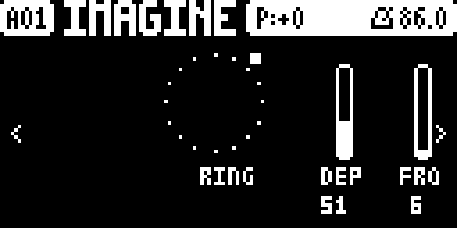
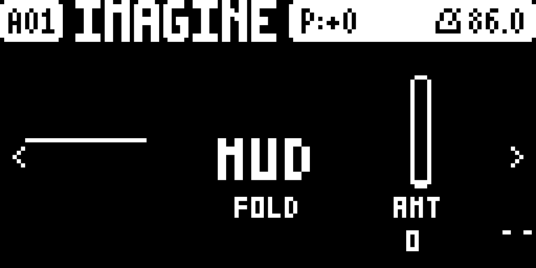
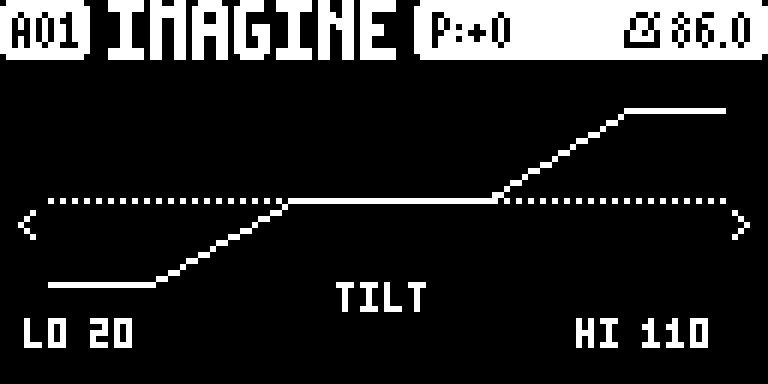
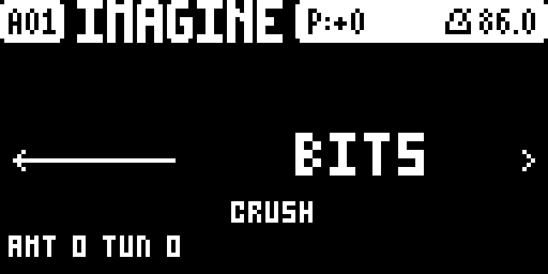
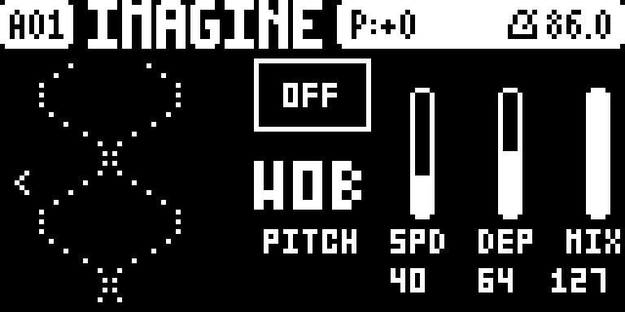
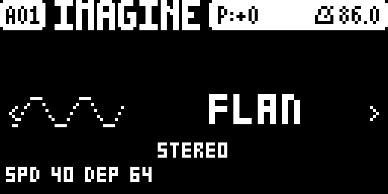

# Tone+FX

**A master effect suite for the Elektron Digitone mk1 / Digitone Keys (OS 1.43).**

Tone+FX is a set of [elekloader](https://github.com/irpina/elekloader) mods,
**packaged and released together as one suite**. It adds master ring modulation,
a low/high-shelf EQ, a Crunch/Redux lo-fi stage, a wavefolder with four fold
modes (plus an internal overdrive), a modulation insert with five modes (wobble,
pitch shift, flanger, autopan, stereo width) on two pages, output metering, an
**eleven-page UI** on the master page tree (a static **PERFORM** page whose 16
trigs are momentary performance pads, plus four one-slider **macro** pages —
**WASH / RADIO / DESTROY / SPACE**) and an animated TONE+FX boot splash.

This repository is **release-only**: it ships the built `.elemod` packages and
the docs to install them. It contains **no source and no firmware**. The source
lives in the development repo, so this repo stays a safe place to cut releases
from while the older `RingTone` repo is still around.

> Unofficial and unsupported. Not affiliated with, endorsed by or supported by
> Elektron. Flashing modified firmware is at your own risk.

## Pages

Eleven master pages (**FUNC + LFO**; **LEFT / RIGHT** rotates). Each new FX page
has a frameless animated graphic in the leftmost third that collapses to a line
when the effect is at neutral; the **PERFORM** page is static (no animation) and
is reached with **UP** from any of the other pages; the four **macro** pages each
show one vertical slider plus a per-page graphic.

| RING | FOLD | TILT |
|---|---|---|
|  |  |  |

| CRUSH | PITCH | STEREO |
|---|---|---|
|  |  |  |

| PERFORM |
|---|
|  |

| WASH | RADIO | DESTROY | SPACE |
|---|---|---|---|
| one-slider macro | one-slider macro | one-slider macro | one-slider macro |

Any page whose section is switched off draws a small framed **OFF** box.

## The suite

**One file is the whole suite:** [`elemods/tonefx-3.5p.elemod`](elemods/) bundles
every mod below into a single elekloader mod, so it **combines with your other
mods**. It does **not** include the required core — install `core-dn1-2.0a.elemod`
too (elekloader provides it), plus anything else you use.

- **digimeter** — output level metering (drawn on the DIGI FOLD page).
- **digieq** — master low-shelf / high-shelf EQ (LO + HI knobs).
- **digiring** — master ring modulator / tremolo, with an animated page.
- **digicrush** — Crunch / Redux: bit-reduce (BITS), sample-rate hold (SR) or a
  hard-clip drive (CRUNCH), one stateless stage at a time.
- **digifold** — master wavefolder with CLEAN / MUD / DIST / TRSH fold modes and
  an internal overdrive; a spiral display.
- **digiwave** — one modulation engine, **two pages**: **PITCH** (WOB pitch
  wobble, SHFT pitch shift) and **STEREO** (FLAN flanger, PAN autopan, WIDE
  stereo width).
- **digictl** — the pages and all the controls; keeps the settings per pattern
  and adds MIDI CC control, plus the **PERFORM** page and its momentary trig
  pads.
- **tonesplash** — an animated TONE+FX boot splash (one of three animations per
  boot, drawn at the intro).

Everything is `GPL-2.0-or-later` (see [`LICENSE`](LICENSE)).

## Install

1. Get **elekloader** and your own stock
   `Digitone_and_Digitone_Keys_OS1.43.syx` (Elektron's download). elekloader
   builds a custom OS on your machine; it never distributes firmware.
2. In elekloader's window, add the stock `.syx`, then **+ Install from file…**
   and pick `core-dn1-2.0a.elemod` (the required core; elekloader ships it) and
   `tonefx-3.5p.elemod` (the whole suite). Add any of your other mods too.
3. Tick the core and `tonefx`, set the OS version tag, and **BUILD FIRMWARE**.
4. Flash the resulting `.syx` with Elektron Transfer, as for any OS update;
   press **YES** on the unit and do not power off until it finishes.

Or from the command line (elekloader from source):

```powershell
# Windows PowerShell
./tools/build.ps1 -Stock "Digitone_and_Digitone_Keys_OS1.43.syx" -Out ToneFX.syx -Version 3.5p
```

```sh
# POSIX
sh tools/build.sh Digitone_and_Digitone_Keys_OS1.43.syx ToneFX.syx 3.5p
```

**Recovery** (the bootloader is never changed): hold **FUNC** while powering on
for the startup menu, press **TRIG 4 (OS UPGRADE)**, then send the stock `.syx`
with Transfer's legacy OS upgrade mode.

## Use

The pages live on the **master page tree**: **FUNC + LFO** cycles the master
pages. Tone+FX appends eleven of its own after the stock ones. **LEFT / RIGHT**
(or the on-screen `<` `>` arrows) rotate the whole master page list, and **UP**
jumps to the **PERFORM** page from any of the other pages (UP again returns). The
stock **top status bar** (pattern name, tempo, …) stays visible above every page.
PAGE keeps its stock meaning; no stock key or encoder is taken.

| page | encoders | shows |
|---|---|---|
| **RING** | **A** on/off · **E** depth · **F** frequency | a centred ring animation |
| **FOLD** | **A** on/off · **D** fold type · **E/F/G/H** amount | the spiral, the big mode title, the amount slider + L/R meter |
| **TILT** | **A** on/off · **E** low shelf · **H** high shelf | a bent low/high response curve |
| **CRUSH** | **A** on/off · **D** mode · **E** amount · **F** tune | a waveform (left) that is quantised / held / clipped by the mode |
| **PITCH** | **A** on/off · **D** mode · **E** speed · **F** depth | two vertical lines that wobble and intertwine |
| **STEREO** | **A** on/off · **D** mode · **E** speed · **F** depth · **G** mix · **H** feedback | a horizontal line that ripples / splits / spreads |
| **PERFORM** | **A** ring depth · **B** fold amount · **C** crush amount · **D** wave pitch depth · **E** wave stereo depth · **F** EQ low · **G** EQ high · **H** wave speed | a static depth readout per FX block; the trigs are momentary pads (see **Performance controls**) |

Every parameter is **0–127** and moves **one step per notch** — the stock
convention (EQ LOW/HIGH are 0–127 with **64 = flat**).

**Per-pattern settings** (store block 1 `"DGX1"` **v10** + block 2 `"DGX2"`
**v1**): the settings — including the macro pages — follow a pattern switch /
reload and travel with a project save, like stock parameters. Each page
**true-bypasses** when its **A** is off (fades out, then stops using CPU). An FX
or macro page that is off draws a framed **OFF** box.

### Fold type (FOLD, encoder D)

Continuous **0–127** spread over four modes (interpolated, capped at CLEAN/TRSH):
**CLEAN** (36 % fold) · **MUD** (full fold) · **DIST** (36 % fold + overdrive) ·
**TRSH** (full + overdrive). The overdrive is a stateless saturation, applied
only in DIST/TRSH.

### PITCH modes (PITCH, encoder D)

**WOB** — vibrato: a modulated, interpolated short delay. **SHFT** — pitch shift
(±12 st) from two crossfaded grains. **E** speed, **F** depth (detune / semitones).

### STEREO modes (STEREO, encoder D)

**FLAN** — flanger (modulated delay + feedback; feedback capped at 75 % to avoid
self-oscillation). **PAN** — autopan. **WIDE** — stereo width (64 = bypass).
**E** speed, **F** depth, **G** mix (flanger), **H** feedback (flanger).

### CRUSH modes (CRUSH, encoder D)

**BITS** — bit-reduce to 24…4 bits, optional TPDF dither (**F** tune). **SR** —
sample-and-hold decimator. **CRUNCH** — Q8 gain into a hard clip.

### MIDI CC control

All FX parameters respond to **incoming MIDI CC** on numbers the Digitone does
not use; a CC move is saved with the pattern. On/off switch at value **64**;
EQ LOW/HIGH are 0–127 with **64 = flat**. CCs on **any** MIDI channel drive the
master FX.

| CC | parameter | CC | parameter |
|---|---|---|---|
| `8` | RING depth | `40` | FOLD amount |
| `11` | RING on/off | `41` | FOLD type |
| `36` | RING rate | `67` | EQ on/off |
| `37` | FOLD on/off | `68` | meter on/off |
| `69` | EQ low shelf | `96` | EQ high shelf |
| `20` | CRUSH on/off | `21` | CRUSH mode |
| `22` | CRUSH amount | `23` | CRUSH tune |
| `24` | WAVE on/off | `25` | PITCH mode |
| `26` | WAVE speed | `27` | WAVE depth |
| `28` | WAVE mix | `29` | WAVE feedback |
| `30` | STEREO mode | `31` | WAVE group |

Signal order on the master mix is **ring → EQ → crush → fold → wave → meter**.
Ring, EQ and fold are on by default.

## Performance controls

A **static** touch page — **PERFORM** — on the master page tree. Press **UP**
from any of the six DIGI pages to reach it (**UP** again returns), or cycle onto
it with **LEFT / RIGHT**. It draws no animation, so it adds no CPU while it is
open.

The **eight encoders set one depth per FX engine** (0–127, one step per notch,
saved with the pattern like every other DIGI control). Every engine has its own
depth — fold and crush are separate, and the WAVE engine has an independent
pitch depth and stereo depth:

| encoder | engine depth | encoder | engine depth |
|---|---|---|---|
| **A** | RING depth | **E** | WAVE stereo depth |
| **B** | FOLD amount | **F** | EQ low shelf |
| **C** | CRUSH amount | **G** | EQ high shelf |
| **D** | WAVE pitch depth | **H** | WAVE speed |

**The 16 trig keys are momentary performance pads**, one block per engine. A
block of four pads is four increasing intensities (1–4); the two-pad fold and
crush blocks use intensities **2 and 4**:

| trigs | block | what the pad drives |
|---|---|---|
| **1 2 9 10** | **RING** | ring depth |
| **3 4** | **FOLD** | fold amount |
| **11 12** | **CRUSH** | crush amount |
| **5 6 13 14** | **PITCH** | the WAVE pitch depth |
| **7 8 15 16** | **STEREO** | the WAVE stereo depth |

**Hold a pad:** it saves the engine's resting value (and its on/off), turns the
engine on, and **ramps its depth up** to `resting + (127 - resting) * intensity
/ 4`, where it holds. **Release:** the depth ramps back to the pattern value and
the on/off is restored. A pad **never writes the per-pattern store**, so the
saved value is always the resting position — releasing, leaving the page, or
even saving the project mid-pad leaves your values intact. The ramp is one cheap
step per audio block, so it is smooth and click-free and costs almost nothing
while idle. Because each engine has its own depth, the pads never fight: a pitch
pad cannot move the stereo depth, and a fold pad cannot move crush.

## Macro pages

Four **one-knob macro** pages bundle several engines behind a single amount
control. Each shows one vertical slider on the right (**A** = on/off, **B–H** =
amount) and a per-page animated graphic on the left; the macro drives the
engines while it is on and restores them when it turns off.

| page | graphic | what it drives |
|---|---|---|
| **WASH** | shore band | wobble (WAVE WOB) + SRR (CRUSH SR) + an EQ tilt |
| **RADIO** | big ring + cone | a band cut (EQ) + TRSH fold drive + CRUSH |
| **DESTROY** | stair-stepped sine | fold + bit-reduction + ring modulator |
| **SPACE** | splitting centre line | WAVE stereo width |

## CPU footprint

Everything runs on the Digitone's **main CPU (Core A)**; the FM DSP (Core B) is
untouched. Approximate instructions per active stereo frame (32 frames/block,
1500 blocks/s); a bypassed section costs ~0. Cheapest → heaviest:

| # | block / mode | ≈ insn/frame |
|---|---|---|
| 1 | CRUSH — BITS | ~10 |
| 2 | CRUSH — SR | ~12 |
| 3 | meter | ~15 |
| 4 | WAVE — WIDE | ~18 |
| 5 | FOLD — CLEAN/MUD | ~20 |
| 6 | WAVE — PAN | ~24 |
| 7 | CRUSH — CRUNCH | ~25 |
| 8 | RING | ~28 |
| 9 | EQ | ~30 |
| 10 | FOLD — DIST/TRSH | ~35 |
| 11 | WAVE — WOB | ~45 |
| 12 | WAVE — FLAN | ~55 |
| 13 | WAVE — SHFT | ~75 |

Turn off the pages you are not using; each true-bypasses. Full ledger in
[`docs/OPTIMIZATION.md`](docs/OPTIMIZATION.md).

**Output ceiling:** a final soft limiter keeps the master mix below the 24-bit
full scale (transparent below ~-2.5 dBFS, asymptotic max ~-0.7 dBFS), so a hot
flanger-feedback / pitch-shift / drive setting cannot hard-clip.

### Load — yours to manage

The Digitone's **CPU and DSP are shared** between the internal FM voices and
these added effects, so Tone+FX is a budget you spend: it is happiest when you
leave headroom for the synth itself. A few habits keep it clean on a busy unit:

- **Turn off the filter on tracks you are not using** — set the track's
  **filter type to 0 (off)**. An idle track's filter still costs CPU for its
  voices every block; freeing it buys that time back for the master FX.
- **A busy pattern has less CPU headroom.** More voices, notes and parameter
  locks on the FM engine leave less for the master FX. On busy patterns, back
  off RING depth / FOLD amount / CRUSH / WAVE, and turn off the pages you are
  not using (each true-bypasses to ~0 cost).
- **The animated panels are for setting up, not for staying on.** The RING /
  FOLD / TILT / CRUSH / PITCH / STEREO pages redraw every UI frame, and that
  redraw is CPU while the page is on screen. Dial the effect in, then **move on**
  — press **UP** to the static **PERFORM** page, or go to any internal page or
  panel. Once you leave a DIGI page it stops redrawing, and that CPU comes back.

## Releases

- `elemods/` at the repository root is the **current release** (this is what
  [`SHA256SUMS`](SHA256SUMS) covers).
- [`releases/`](releases/) holds a **packaged copy of each cut release**
  (`README`, `CHANGELOG`, `LICENSE`, `SHA256SUMS`, `elemods/`, `tools/`,
  `Screenshots/` and the `.zip`), newest first.
- [`archive/`](archive/) holds **superseded releases** (e.g. `2.1h`).

## Verify a download

```sh
sha256sum -c SHA256SUMS        # or: Get-FileHash elemods/* -Algorithm SHA256
```

## Status

Tested in the **digiemu** emulator (boot/settle, `dsp_running=2`, all eleven
pages, and a live-audio check of the PERFORM page: an encoder raises the pattern
value, a held trig ramps its block and release restores it). On hardware the 3.2
line is
**stress-tested on two Digitone mk1 units — in parallel and in series — over
synths, drums, vocals and master tracks (including vinyl)**, as well as on a
single unit. Current package version is in [`CHANGELOG.md`](CHANGELOG.md). No
firmware is included or distributed here; the `.elemod`s carry only our own code
and patch sites (byte-checked against your stock file at build time).

## Known bugs / future fixes

Tracked as they come up; nothing here blocks normal use.

**Bugs / rough edges we want fixed**

- **PAGE still jumps some FX levels:** pressing the **PAGE** key can still push
  some DIGI parameters to a high value — the stock-event store guard does not
  cover every path yet.
- **PITCH fires on a note-off:** a **PHASER** trig can activate the PITCH (WAVE)
  effect on the **note-off** message instead of on the note.
- ~~**Microtiming / locked trigs on MIDI tracks:** LEFT / RIGHT would not nudge a
  MIDI-track trig and the volume could jump.~~ **Fixed in 3.5p** — the
  key/encoder handlers now disarm the moment the master view closes.
- **Slider feel:** the page sliders and value bars should track the stock
  parameter widgets more closely.
- **Encoder acceleration:** the base rate is stock (one step per detent); the
  fast-turn curve is whatever the OS driver delivers, so a fast spin can feel
  different from a stock parameter.
- **SHFT quality:** the pitch shifter is deliberately lightweight (linear
  interpolation, ~10 ms grains) and a little warbly — a quality pass, or a
  hi-fi option, is wanted.
- **WOB / SHFT have no dry-wet:** MIX is used by FLAN only. Exposing a blend
  (a MIX on WOB/SHFT) is wanted so they dial in like the flanger.
- **PERFORM trig LEDs:** the pads do not yet light the trig keys (yellow) — a
  planned follow-up, once the Digitone LED driver is reverse-engineered.
- **Configured-MIDI-track store risk:** the per-pattern block lives in an unused
  MIDI-track area that was zero on *unconfigured* tracks; a magic guard protects
  it, but if a configured MIDI track is found to write there, the block must move.
- **Power-off persistence** rides on the OS saving the temp project; a project
  round-trip is confirmed per pattern in the emulator, not yet exhaustively on
  hardware.

**Wanted next (features / quality)**

- **LFO destinations:** drive the DIGI parameters from a track LFO (a bridge is
  parked in the source; it needs the stock destination table).
- **Pre-FX routing:** an option to place the chain before the sends/return
  effects instead of after them.
- **Fuse the six master passes** into one loop — order-of-magnitude fewer
  loads/stores per frame, real CPU back.
- **Redraw gating:** only redraw an animated page while it is visible, and fold
  the meter into the fused loop.
- **More PERFORM pads:** pads for EQ, WAVE speed and CRUSH tune, and optionally
  tempo-synced ramp shapes.
- **Measured headroom:** render-worst / deadline margin and peak/RMS dB with the
  FX off vs on, so the load advice is measured rather than estimated.
- **CC 20–31:** verify against the stock CC table (`0x4018D104`) before
  sequencing WAVE/CRUSH from a DAW.
- **Output ceiling:** confirm it is inaudible at normal levels and matched to the
  24-bit full scale.
